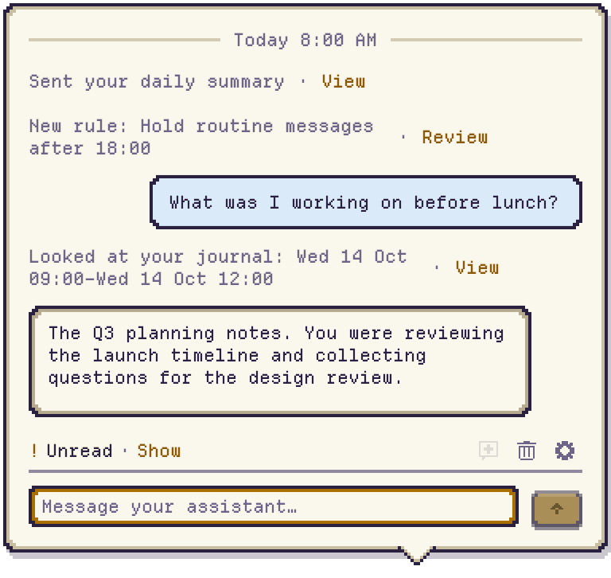

<p align="center">
  <picture>
    <source media="(prefers-color-scheme: dark)" srcset="docs/readme/hero-dark.gif">
    
  </picture>
</p>

<p align="center">
  A little character. A capable assistant. Right on your Mac.<br>
  Works with Claude Code, Codex and OpenCode.
</p>

<p align="center">
  <a href="https://github.com/colinc86/zeus/releases/latest"><b>Download for macOS</b></a>
  &nbsp;·&nbsp; <a href="docs/SETUP.md">Get started</a>
  &nbsp;·&nbsp; <a href="docs/README.md">Documentation</a>
  &nbsp;·&nbsp; macOS 26+
</p>

Your assistant works in a terminal you're not watching. Zeus gives it a face, a voice on your desktop, and a place to talk. It asks a question, you click an answer. It finishes the work, you open the file. And when you let it learn, it gets better at knowing when and how to help.

## An assistant that learns you

<picture>
  <source media="(prefers-color-scheme: dark)" srcset="docs/readme/learning-dark.png">
  
</picture>

Less explaining yourself. Better timing. Help with the thing you were just doing.

**Learn from me** gives your assistant context: apps and timing, windows and pages, occasional pictures of the front window, or topics from your typing. All four levels start off. You choose what to share, and Zeus applies its privacy safeguards on your Mac before keeping a record.

A readable record lives in your assistant’s folder, so it can pick up the thread across days and keep its own notes about what helps you. Morning summaries and evening reflections help it notice patterns. **Rules** turn useful patterns into habits: hold routine messages after work, or act for you after you've approved the rule. Purchases always ask.

Lost your place? Ask about your day, or use **Ask About This** to bring the window in front into the conversation. **What Zeus Kept** lets you inspect the records, see what was sent, and delete what you don't want kept.

[Explore Learn from me →](docs/LEARNING.md) · [Privacy and controls](docs/PRIVACY.md)

<br clear="right">

## A conversation, always close by

<picture>
  <source media="(prefers-color-scheme: dark)" srcset="docs/readme/conversation-dark.png">
  
</picture>

Zeus thinks, works and cheers along with your assistant. A small speech bubble brings you a question without taking focus from your work.

- **Answer in a click.** Choose an option or type a reply.
- **Get the finished thing.** Open files, folders and links straight from the conversation.
- **Drop it on Zeus.** Files, pictures, text and links become attachments, ready to send.
- **Know what's waiting.** The status strip takes you to the question or unread message that needs you.
- **Make room for quiet.** Quiet hours, timed hiding and rules keep interruptions in check.

[Messages, questions and shortcuts →](docs/CONVERSATION.md)

<br clear="left">

<p align="center">
  <picture>
    <source media="(prefers-color-scheme: dark)" srcset="docs/readme/peek-dark.png">
    
  </picture>
</p>

## Pick your assistant. Zeus looks after it.

<picture>
  <source media="(prefers-color-scheme: dark)" srcset="docs/readme/settings-dark.png">
  
</picture>

Choose Claude Code, Codex or OpenCode, pick a folder, and press **Start**. Zeus runs it in tmux and reconnects when you next open Zeus. **Open in Terminal** lets you look in whenever you like.

You choose the agent's permission mode. Zeus can show its permission questions in the chat; you choose the answer. It never accepts a prompt for you.

Already have a setup you like? **Connect your own** joins a session you run yourself.

[Set up your assistant →](docs/SETUP.md) · [Restarts and updates](docs/ASSISTANT.md)

<br clear="right">

## Give it some character

<p align="center">
  <picture>
    <source media="(prefers-color-scheme: dark)" srcset="docs/readme/roster-dark.gif">
    
  </picture>
</p>

Twelve characters. Seven themes. A pixel font or SF Mono. Make Zeus small, move it to your favorite corner, or let it fade when idle.

<p align="center">
  <picture>
    <source media="(prefers-color-scheme: dark)" srcset="docs/readme/themes-dark.png">
    
  </picture>
</p>

Characters and themes are editable JSON files. Import one, make your own, or ask your assistant to make one for you. Appearance changes made through Zeus's tools come with **Undo**.

[Characters, themes and making your own →](docs/CUSTOMIZATION.md)

## How it works

1. **Your agent does the work.** Zeus runs one assistant or connects to yours.
2. **Zeus brings it to you.** A bundled MCP server gives the assistant tools for messages, questions, finished work and status.
3. **Your answer goes back.** Zeus saves replies and retries delivery when needed. The assistant acknowledges them and ignores repeats.

Zeus's learning and redaction run locally, using Apple's on-device frameworks. Your assistant reads its folder and what Zeus sends it; where that goes depends on the assistant you chose. Zeus never edits your saved agent configuration or credentials.

[Privacy and security](docs/PRIVACY.md) · [MCP tool reference](docs/MCP.md)

## Install

1. Download `Zeus-<version>.dmg` from [Releases](https://github.com/colinc86/zeus/releases/latest).
2. Open it and drag **Zeus** into **Applications**.
3. Open Zeus and choose your assistant in **Settings › Assistant**.

You'll need **macOS 26 or later**, **tmux** (`brew install tmux`) for an assistant Zeus runs, and an installed, signed-in Claude Code, Codex or OpenCode CLI. Release builds check for Zeus updates automatically.

[Full setup guide →](docs/SETUP.md)

## Build and contribute

With Xcode 26 and XcodeGen installed:

```sh
brew install xcodegen tmux
scripts/build.sh
scripts/test.sh
open build/DerivedData/Build/Products/Debug/Zeus.app
```

Quit another running copy of Zeus before opening a development build. Debug builds are ad-hoc signed and do not check for updates.

Read [AGENTS.md](AGENTS.md) before contributing. See the [engineering contract](docs/CONTRACT.md), [design specs](docs/README.md#for-contributors) and [release guide](docs/RELEASE.md) for development details.

## License

[MIT](LICENSE). The bundled Departure Mono font uses the SIL Open Font License; its license ships alongside it.
