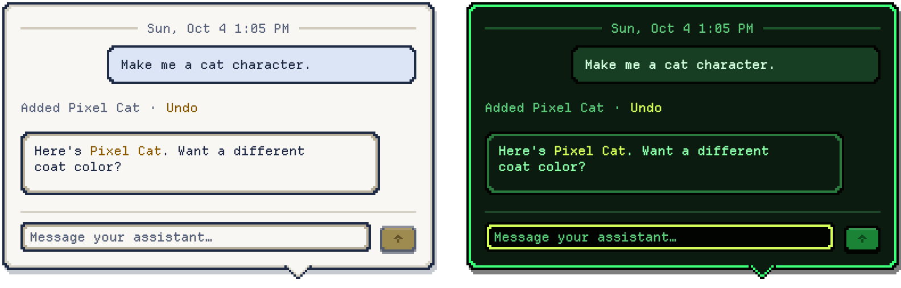
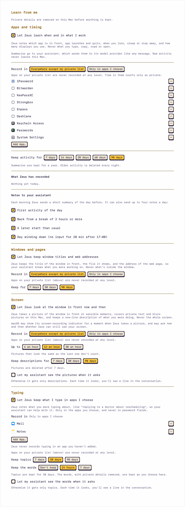
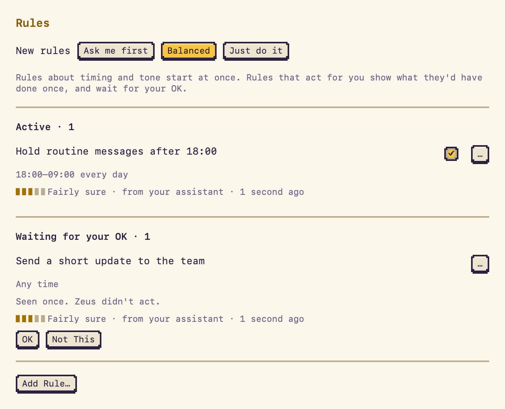
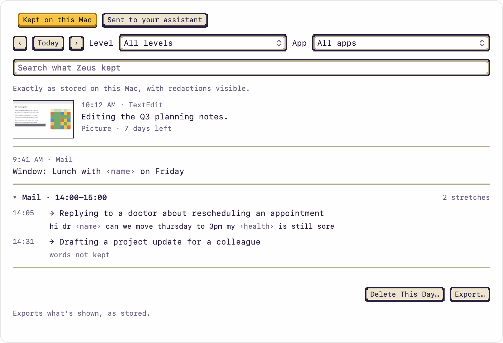

<p align="center">
  <picture>
    <source media="(prefers-color-scheme: dark)" srcset="docs/readme/hero-dark.gif">
    
  </picture>
</p>

<p align="center">
  Compatible with Claude Code, Codex or OpenCode.
</p>

<p align="center">
  <a href="https://github.com/colinc86/zeus/releases/latest"><b>Download for macOS</b></a>
  &nbsp;·&nbsp; <a href="docs/SETUP.md">Setup guide</a>
  &nbsp;·&nbsp; macOS 26 or later
</p>

## What it does

<picture>
  <source media="(prefers-color-scheme: dark)" srcset="docs/readme/conversation-dark.png">
  
</picture>

Your assistant works in a terminal you're not watching. Zeus sits on your desktop and keeps you in the loop.

- **Shows what it's doing.** Zeus thinks, works and cheers along with your assistant, with a progress bar when there is one, and knows when your assistant's turn ends.
- **Asks, and you answer in one click.** When your assistant needs a decision, a speech bubble pops up next to Zeus. Click an answer, or type one.
- **Hands you finished work.** Files, folders and links, ready to open.
- **Sends your replies back.** Type to Zeus and your message goes straight to your assistant.
- **Takes anything you drop on it.** Drag files, folders, text, images or links onto Zeus and the conversation opens with them attached, ready to send. If Zeus runs your assistant, a dropped folder can become its working folder.
- **Tells you what's waiting.** A strip above the message field says why Zeus shows "?" or "!" and takes you there in one click. **Skip** a question you'd rather not answer. Its four buttons open Terminal, start a new conversation, clear the conversation and open Settings.
- **Knows when to be quiet.** Set quiet hours and Zeus won't bother you.

<br clear="right">

<p align="center">
  <picture>
    <source media="(prefers-color-scheme: dark)" srcset="docs/readme/peek-dark.png">
    
  </picture>
</p>

## Zeus can run your assistant for you

<picture>
  <source media="(prefers-color-scheme: dark)" srcset="docs/readme/settings-dark.png">
  
</picture>

Zeus starts the assistant in its own tmux session, keeps it running, and picks up the same conversation on each launch. Peek in whenever you like with **Open in Terminal**, or copy the `tmux attach` command.

You pick its permission mode. When it asks for permission, you answer right in the chat. Zeus never answers for you. When the agent installs an update, Zeus says so in the conversation and restarts it when you're ready, keeping the conversation.

Already run your assistant yourself? Choose **Connect your own** and Zeus joins the session you started.

<br clear="left">

## Customize your assistant

<p align="center">
  <picture>
    <source media="(prefers-color-scheme: dark)" srcset="docs/readme/roster-dark.gif">
    
  </picture>
</p>

Twelve cute characters to choose from, or build your own (see [Make your own character](docs/SETUP.md#make-your-own-character) and [the sprite format](docs/design/SPRITE_FORMAT.md)).

<p align="center">
  <picture>
    <source media="(prefers-color-scheme: dark)" srcset="docs/readme/themes-dark.png">
    
  </picture>
</p>

Seven themes color the conversation and Zeus's speech bubble: Classic, Midnight, Parchment, Olympus, Phosphor, Pocket and Sorbet (Settings › Appearance). Themes and characters are plain JSON files: press **Open Example** to see how one is made, or **Import Theme…** and **Import Character…** to add one someone sent you.

**Fade Zeus when idle** makes the character see-through until you need it. Drag the conversation panel's edge to make it wider.

## Your assistant can control Zeus

Ask, and your assistant can change anything you could change by clicking: the character or theme (including ones it makes for you), Zeus's size and place on screen, hiding Zeus for a while, and the appearance settings. It never changes its own authority: it can't answer its own prompts, change its permissions, instructions or folder, start or stop itself, clear the conversation or turn on Learn from me.

Every change shows up as one line in the conversation with an **Undo**:

> **You:** Make me a cat character.<br>
> Added Pixel Cat · **Undo**

It can also check for updates and install one when you ask. Two switches in Settings › General turn this off: **Let my assistant control Zeus** and **Let my assistant install updates**.

## Zeus learns how you work

<picture>
  <source media="(prefers-color-scheme: dark)" srcset="docs/readme/privacy-dark.png">
  
</picture>

Off until you turn it on in **Settings › Privacy**. Learning works in four levels. Each has its own switch, shows an example of what it keeps before you turn it on, and asks for its own macOS permission:

- **Apps and timing.** Which app is in front, apps opening and quitting, when you lock, sleep or step away. No permission needed.
- **Windows and pages** (Accessibility). The title of the window in front, the file it shows, and the web address in Chrome and Edge. Never what's inside a window.
- **Screen** (Screen Recording). One picture of the window in front, never the whole screen, when something has changed: after you've settled on an app or document, every 5 minutes in the same place, when you come back from a break, and when you ask. Never during a video call, while presenting, while a password field is active, or in private windows. On your Mac, Zeus reads the picture's text and covers the private parts, pixellates every picture and face in it, then writes a one-line description of what you were doing. Pictures are deleted after 7 days and descriptions after 7, 30 or 90, and you cap it at 4, 12 or 30 pictures an hour.
- **Typing** (Input Monitoring). What you were typing about in the apps you choose, as a one-line topic per stretch of typing. A password field turns on macOS secure input, so none of its characters ever reach Zeus. Pasted text is never read: Zeus notes only that you pasted. Topics are kept for 30 days and the words, with private details removed, for 24 hours, or not at all with **Don't keep**, which keeps topics only. While a password field is active, the Zeus menu says *Private input: Zeus isn't noting typing*.

Each level records **everywhere except my private list** or **only in apps I choose** (Typing is always the second). Safari is the exception: Zeus can't tell its private windows apart, so at every level it records only that you used Safari unless you add it yourself. A browser that can't say whether a window is private is treated as private.

**How the filtering works, on your Mac.** Private details are removed before anything is stored, not just before it's sent. Fixed patterns catch emails, card numbers and passwords, `NSDataDetector` finds phone numbers and addresses, the NaturalLanguage framework tags names, and Apple's on-device Foundation Model handles the rest (health, money and secrets in plain prose) and writes the screen descriptions and typing topics. Vision reads the text in pictures and finds faces. Nothing is sent to Apple's Private Cloud Compute or to any cloud by Zeus: it has no models of its own. What was removed shows as a placeholder like ‹name›, for you and your assistant alike. The journal is encrypted on disk with a key in your keychain.

<br clear="right">

**What your assistant gets.** Each morning, a short summary of the day before, so it can pick better moments to help and have the right things ready. When you ask it about your day ("what was I reading at 3?"), it can look in the journal and gets summaries, descriptions and topics. It gets a picture or the words only if you turn on **Raw on request** for that level, and even then only the covered picture or the redacted words, never the original. Every answer appears in the conversation (*Looked at your journal: Tue 14:00–15:30 · View*) and in the **Sent to your assistant** ledger, exactly as sent. Your assistant sends what it gets to its model provider, like any message.

<picture>
  <source media="(prefers-color-scheme: dark)" srcset="docs/readme/rules-dark.png">
  
</picture>

**Rules.** Once a day, after your work winds down, your assistant looks over the day and may suggest rules about how to help you, like "Hold routine messages after 18:00". Rules about timing and tone start at once, with a quiet line in the conversation. A rule that would act for you first shows what it would have done (*I'd have sent "Running late, 10 min" to the team chat · OK next time?*) and waits for your OK; after that, each time it acts you get *Did: … · Undo*. A rule gains or loses confidence from what happens next, and one you keep skipping or undoing retires itself. **Why?** in Settings › Rules shows the records it came from and everything that happened since. Purchases always ask first, every time, whatever the rule says. The **New rules** dial (Ask me first, Balanced, Just do it) sets how new rules start. Zeus holds messages for timing rules itself, so your assistant can't talk over them.

**Ask About This.** Add Shift to the Talk shortcut (⇧⌥⌘Z) or choose it in the Zeus menu, and the conversation opens with chips for the window in front, your selection, the page's address or a picture of the window, already attached with private details removed. Remove any you don't want to send.

<br clear="left">

<picture>
  <source media="(prefers-color-scheme: dark)" srcset="docs/readme/kept-dark.png">
  
</picture>

**Your controls.** **What Zeus Kept** shows every record exactly as stored, with the placeholders visible, and deletes one record, a day, an app or everything at once. **Sent to your assistant** is the ledger of everything it got. Every level shows an example of what it keeps before it asks for anything, **Pause for Today** stops all of it until midnight, and if your keychain is locked, new records wait in memory and the Privacy pane says so.

**Only your assistant may talk to Zeus.** Any other session that has the Zeus server is refused and never reaches the conversation; the first time, a quiet line says which one tried, with *Make it my assistant · Ignore*.

<br clear="right">

## How it works

- `zeus-mcp` is an MCP server your assistant connects to. Its tools (`zeus_say`, `zeus_ask`, `zeus_present`, `zeus_set_status`, …) drive the character and the conversation panel.
- Your replies go back to the session that asked: through its Terminal pane in tmux, Claude Code's channel or OpenCode's local server. Each one is acknowledged, so a message is never lost or delivered twice.
- Everything stays on your Mac. Zeus uses no cloud models of its own, only Apple's on-device models to remove private details, describe pictures and name typing topics. It never edits your agent's settings and never accepts prompts on your behalf.
- With Learn from me on, your assistant gets summaries, descriptions and topics with private details already removed, and covered pictures or redacted words only when you allow that for a level and it asks. It passes them to its model provider like any message. The journal itself is encrypted and never leaves your Mac.

The interfaces are documented in [docs/CONTRACT.md](docs/CONTRACT.md).

## Install

1. Download the latest `Zeus-<version>.dmg` from [Releases](https://github.com/colinc86/zeus/releases/latest).
2. Open it and drag Zeus into Applications.
3. Open Zeus. It lives in the menu bar and updates itself. Right-clicking Zeus opens the same menu as the menu bar icon, and you can hide the icon in Settings › General.

You need macOS 26 or later, [tmux](https://github.com/tmux/tmux) (`brew install tmux`) and at least one of Claude Code, Codex or OpenCode. Setup takes a minute: see [docs/SETUP.md](docs/SETUP.md).

## Build from source

```sh
brew install xcodegen tmux
scripts/build.sh    # builds ZeusKit and build/DerivedData/Build/Products/Debug/Zeus.app
scripts/test.sh     # package and app tests
open build/DerivedData/Build/Products/Debug/Zeus.app
```

Debug builds are ad-hoc signed and never check for updates. Signed, notarized releases come from `scripts/release.sh` (see [docs/RELEASE.md](docs/RELEASE.md)).

## Contributing

Read [AGENTS.md](AGENTS.md) first. It has the standards every change follows, and it works as instructions for coding agents too (`CLAUDE.md` loads it). For UI changes, include a render from `scripts/design-harness/render.sh`.

## License

MIT. See [LICENSE](LICENSE). The bundled Departure Mono font is under the SIL Open Font License, and its license ships alongside it.
