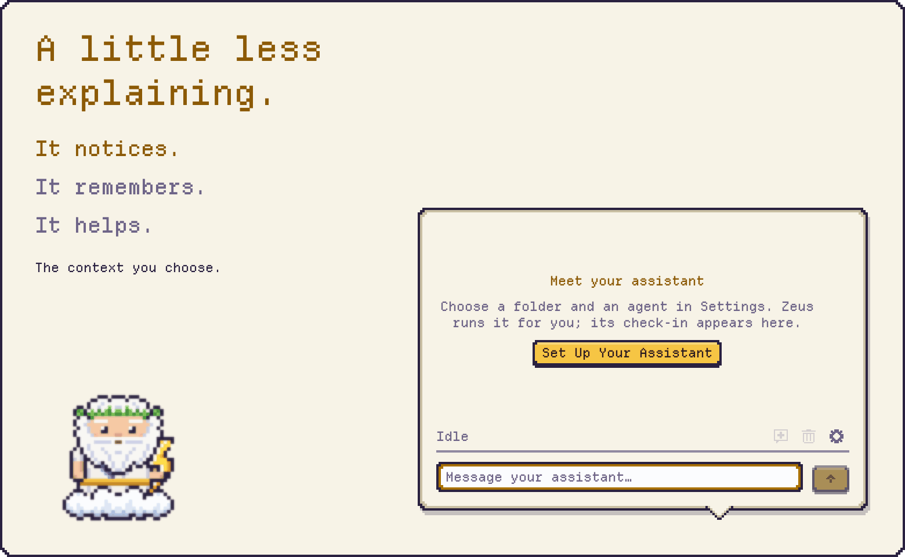

<p align="center">
  <picture>
    <source media="(prefers-color-scheme: dark)" srcset="docs/readme/hero-dark.gif">
    
  </picture>
</p>

<p align="center">
  A little character. A capable assistant. Right on your Mac.<br>
  Works with Claude Code, Codex and OpenCode.
</p>

<p align="center">
  <a href="https://github.com/colinc86/zeus/releases/latest"><b>Download for macOS</b></a>
  &nbsp;·&nbsp; <a href="docs/SETUP.md">Get started</a>
  &nbsp;·&nbsp; <a href="docs/README.md">User manual</a>
  &nbsp;·&nbsp; macOS 26+
</p>

Your assistant works in a terminal you're not watching. Zeus gives it a face, a place to talk, and a way to bring the finished thing to you.

## An assistant that learns you

Less explaining. More picking up where you left off.

<p align="center">
  <picture>
    <source media="(prefers-color-scheme: dark)" srcset="docs/readme/learning-story-dark.gif">
    
  </picture>
</p>

- **It notices.** The work you return to, from the context you choose.
- **It remembers.** Morning summaries and evening reflections help it connect the days.
- **It helps.** Find your place, ask about the window in front, or approve a useful habit.

All four learning levels start off. Rules that act for you need approval; purchases always ask.

[Explore Learn from me →](docs/LEARNING.md) · [Your privacy controls](docs/PRIVACY.md)

## A memory you can open

The record lives beside the work.

Zeus keeps daily records in `Zeus/`; your assistant can keep its own conclusions in `Notes/`. **What Zeus Kept** lets you inspect and delete the records. Redaction runs on your Mac; what your assistant reads follows its provider setup.

```text
Assistant/
├── Zeus/
│   ├── days/2026-10-14/
│   │   ├── activity.md
│   │   └── summary.md
│   ├── reflections/
│   └── rules.md
└── Notes/
```

[Inside your assistant's folder →](docs/LEARNING.md#your-assistants-folder)

## A conversation, always close by

A quick question. A click. Back to your work.

Answer in a click, type a reply, or drop in a file. Finished work opens straight from the conversation. Rate each kind of update: more like this, only when needed, or stop.

<p align="center">
  <picture>
    <source media="(prefers-color-scheme: dark)" srcset="docs/readme/conversation-dark.png">
    
  </picture>
  <picture>
    <source media="(prefers-color-scheme: dark)" srcset="docs/readme/peek-dark.png">
    
  </picture>
</p>

[Messages, questions and shortcuts →](docs/CONVERSATION.md)

## Pick your assistant. Zeus looks after it.

Choose an agent, pick a folder, press **Start**.

Zeus runs Claude Code, Codex or OpenCode in tmux and reconnects next time. You choose the permissions and answer its prompts. **Open in Terminal** lets you look in; **Connect your own** joins a session you already run.

<p align="center">
  <picture>
    <source media="(prefers-color-scheme: dark)" srcset="docs/readme/settings-dark.png">
    
  </picture>
</p>

[Set up your assistant →](docs/SETUP.md) · [Restarts and updates](docs/ASSISTANT.md)

## Give it some character

Twelve characters. Seven themes. Yours to make your own.

Choose a pixel font or SF Mono. Move Zeus to your favorite corner, or let it fade when idle. Characters and themes are editable JSON: import one, make one, or ask your assistant. **Undo** rolls back your assistant’s appearance changes.

<p align="center">
  <picture>
    <source media="(prefers-color-scheme: dark)" srcset="docs/readme/roster-dark.gif">
    
  </picture>
  <picture>
    <source media="(prefers-color-scheme: dark)" srcset="docs/readme/themes-dark.png">
    
  </picture>
</p>

[Characters, themes and making your own →](docs/CUSTOMIZATION.md)

## How it works

Your agent does the work. Zeus brings it to you.

A bundled MCP server gives your assistant tools for messages, questions, finished work and status. Your answers go back to the right session, with saved deliveries and retries. Zeus leaves your saved agent configuration and credentials alone.

[MCP tool reference →](docs/MCP.md) · [Privacy and security](docs/PRIVACY.md)

## Install

Download, drag to Applications, open Zeus.

Get `Zeus-<version>.dmg` from [Releases](https://github.com/colinc86/zeus/releases/latest). You'll need **macOS 26+**, an installed and configured agent CLI, and **tmux** (`brew install tmux`) for an assistant Zeus runs. Choose your agent in **Settings › Assistant**. Release builds check for updates automatically.

[Full setup guide →](docs/SETUP.md)

## Build and contribute

Bring Xcode 26 and XcodeGen.

```sh
brew install xcodegen tmux
scripts/build.sh
scripts/test.sh
open build/DerivedData/Build/Products/Debug/Zeus.app
```

Quit another copy of Zeus before opening a development build. Debug builds are ad-hoc signed and do not check for updates.

[Contributor guide →](AGENTS.md) · [Engineering and design](docs/README.md#for-contributors) · [Releases](docs/RELEASE.md)

## License

[MIT](LICENSE). The bundled Departure Mono font uses the SIL Open Font License; its license ships alongside it.
