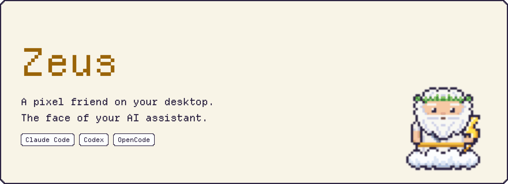
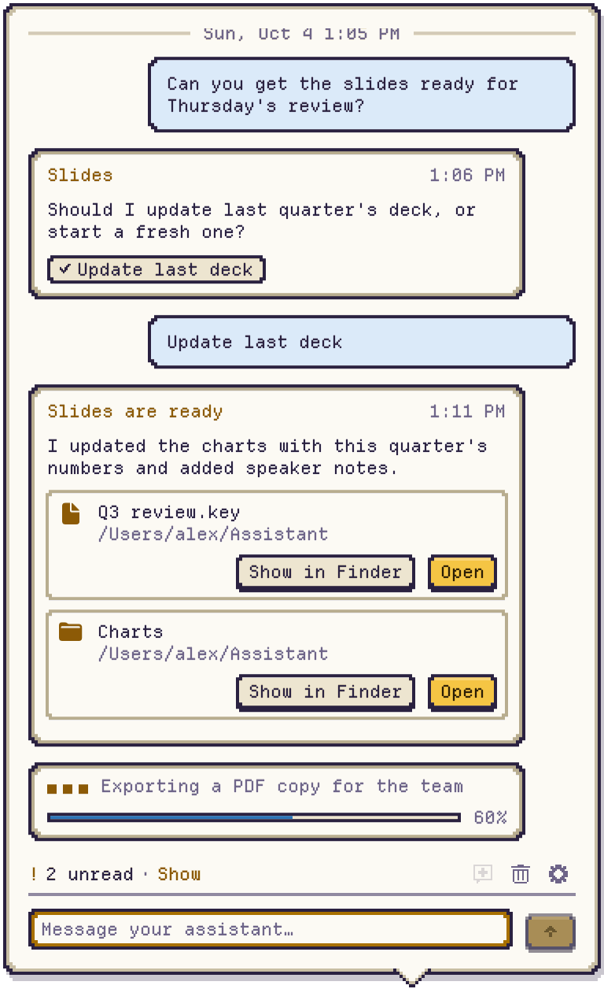
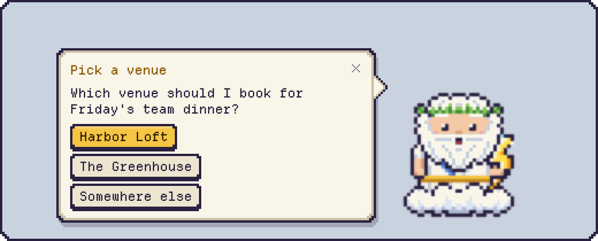
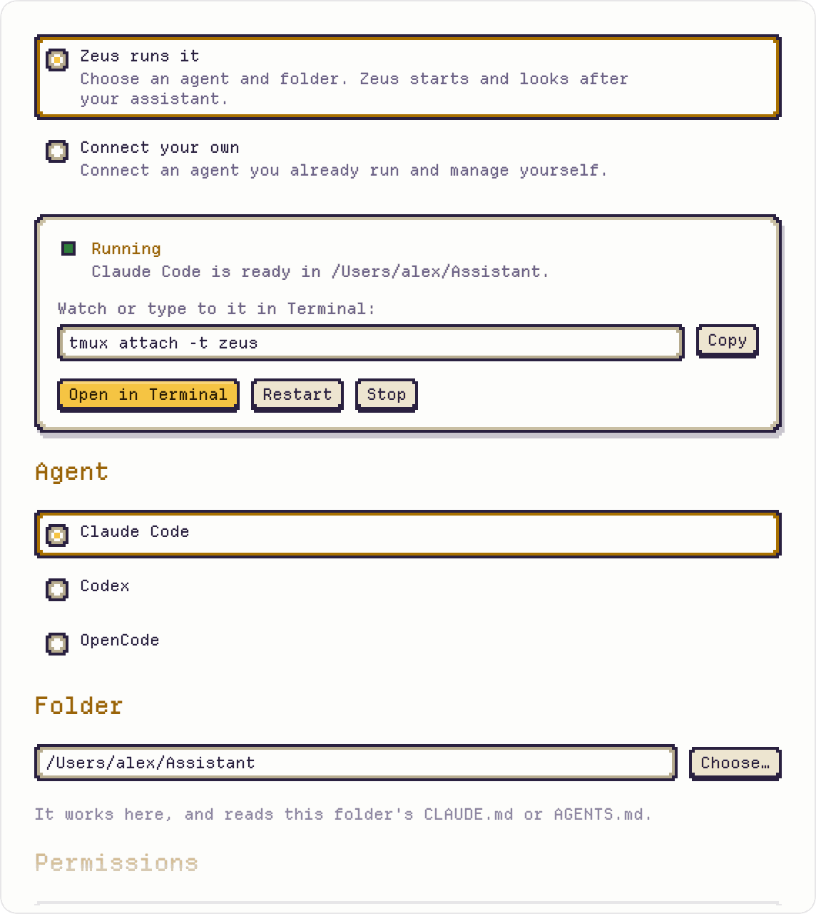
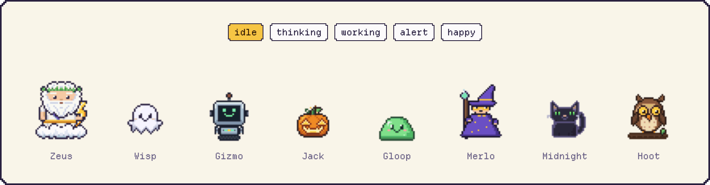

<p align="center">
  <picture>
    <source media="(prefers-color-scheme: dark)" srcset="docs/readme/hero-dark.gif">
    
  </picture>
</p>

<p align="center">
  Compatible with Claude Code, Codex or OpenCode.
</p>

<p align="center">
  <a href="https://github.com/colinc86/zeus/releases/latest"><b>Download for macOS</b></a>
  &nbsp;·&nbsp; <a href="docs/SETUP.md">Setup guide</a>
  &nbsp;·&nbsp; macOS 26 or later
</p>

## What it does

<picture>
  <source media="(prefers-color-scheme: dark)" srcset="docs/readme/conversation-dark.png">
  
</picture>

Your assistant works in a terminal you're not watching. Zeus sits on your desktop and keeps you in the loop.

- **Shows what it's doing.** Zeus thinks, works and cheers along with your assistant, with a progress bar when there is one.
- **Asks, and you answer in one click.** When your assistant needs a decision, a speech bubble pops up next to Zeus. Click an answer, or type one.
- **Hands you finished work.** Files, folders and links, ready to open.
- **Sends your replies back.** Type to Zeus and your message goes straight to your assistant.
- **Knows when to be quiet.** Set quiet hours and Zeus won't bother you.

<br clear="right">

<p align="center">
  <picture>
    <source media="(prefers-color-scheme: dark)" srcset="docs/readme/peek-dark.png">
    
  </picture>
</p>

## Zeus can run your assistant for you

<picture>
  <source media="(prefers-color-scheme: dark)" srcset="docs/readme/settings-dark.png">
  
</picture>

Zeus starts the assistant in its own tmux session, keeps it running, and picks up the same conversation on each launch. Peek in whenever you like with **Open in Terminal**, or copy the `tmux attach` command.

You pick its permission mode. When it asks for permission, you answer right in the chat. Zeus never answers for you.

Already run your assistant yourself? Choose **Connect your own** and Zeus joins the session you started.

<br clear="left">

## Customize your assistant

<p align="center">
  <picture>
    <source media="(prefers-color-scheme: dark)" srcset="docs/readme/roster-dark.gif">
    
  </picture>
</p>

Twelve cute characters to choose from, or build your own (see [the sprite format](docs/design/SPRITE_FORMAT.md)).

## How it works

- `zeus-mcp` is an MCP server your assistant connects to. Its tools (`zeus_say`, `zeus_ask`, `zeus_present`, `zeus_set_status`, …) drive the character and the conversation panel.
- Your replies go back into the assistant's terminal session through tmux. Each one is acknowledged, so a message is never lost or delivered twice.
- Everything stays on your Mac. Zeus never calls model APIs, never edits your agent's settings and never accepts prompts on your behalf.

The interfaces are documented in [docs/CONTRACT.md](docs/CONTRACT.md).

## Install

1. Download the latest `Zeus-<version>.dmg` from [Releases](https://github.com/colinc86/zeus/releases/latest).
2. Open it and drag Zeus into Applications.
3. Open Zeus. It lives in the menu bar and updates itself.

You need macOS 26 or later, [tmux](https://github.com/tmux/tmux) (`brew install tmux`) and at least one of Claude Code, Codex or OpenCode. Setup takes a minute: see [docs/SETUP.md](docs/SETUP.md).

## Build from source

```sh
brew install xcodegen tmux
scripts/build.sh    # builds ZeusKit and build/DerivedData/Build/Products/Debug/Zeus.app
scripts/test.sh     # package and app tests
open build/DerivedData/Build/Products/Debug/Zeus.app
```

Debug builds are ad-hoc signed and never check for updates. Signed, notarized releases come from `scripts/release.sh` (see [docs/RELEASE.md](docs/RELEASE.md)).

## Contributing

Read [AGENTS.md](AGENTS.md) first. It has the standards every change follows, and it works as instructions for coding agents too (`CLAUDE.md` loads it). For UI changes, include a render from `scripts/design-harness/render.sh`.

## License

MIT. See [LICENSE](LICENSE). The bundled Departure Mono font is under the SIL Open Font License, and its license ships alongside it.
